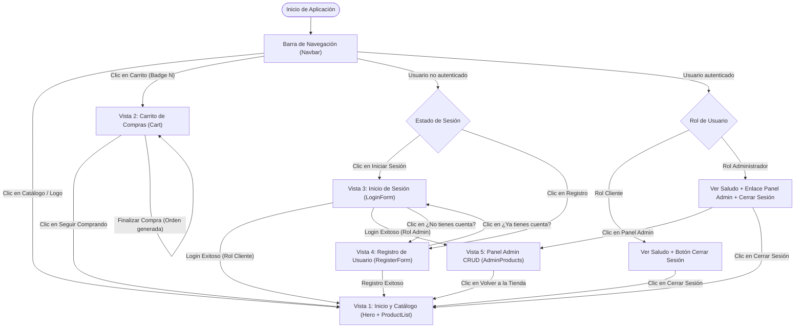
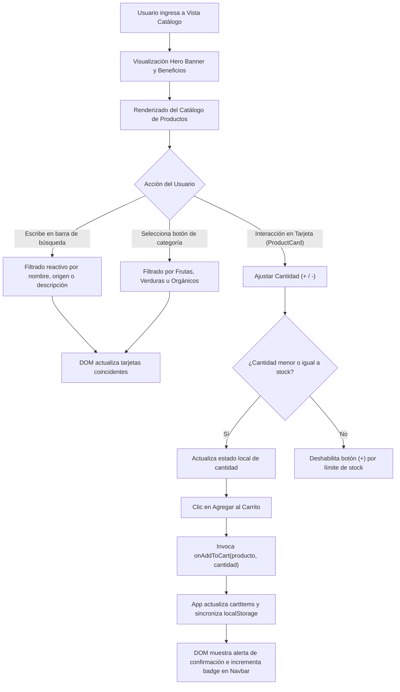
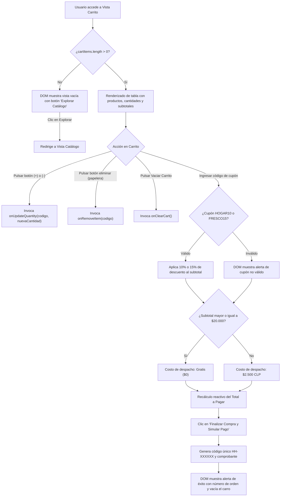
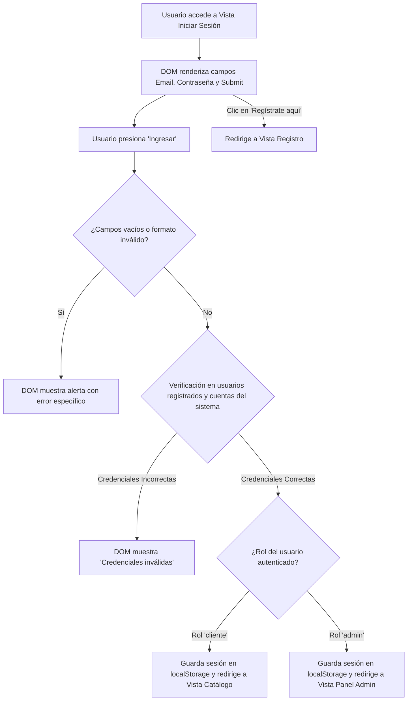
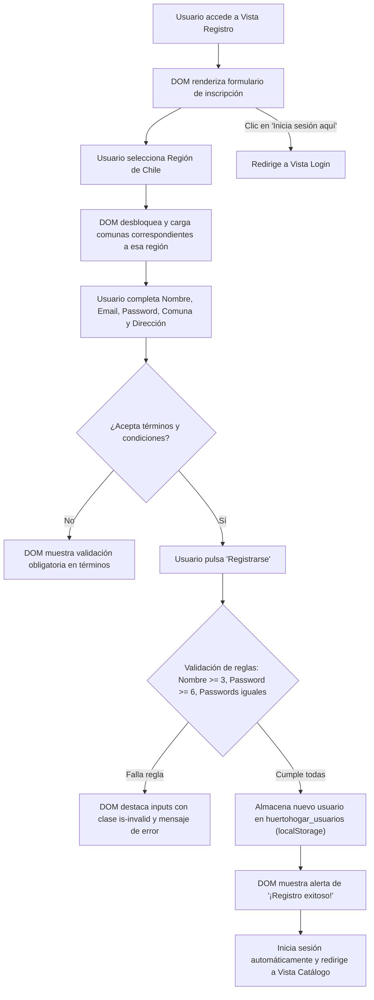

# ESPECIFICACIÓN DE REQUISITOS DE SOFTWARE (ERS)
## Sistema de Comercio Electrónico "HuertoHogar"

- **Asignatura:** Desarrollo de Software Web (DSY1104)
- **Evaluación:** Evaluación N.° 2 — Frontend Moderno en JavaScript, CRUD y Pruebas Unitarias
- **Institución:** Duoc UC — Escuela de Informática y Telecomunicaciones
- **Caso:** Forma A — HuertoHogar
- **Versión:** 2.0.0
- **Fecha:** Octubre 2026

---

## 1. INTRODUCCIÓN

### 1.1. Propósito
El presente documento describe la Especificación de Requisitos de Software (ERS) para la plataforma web de comercio electrónico **HuertoHogar**, especializada en la venta y distribución de productos agrícolas frescos y sostenibles directamente desde productores locales chilenos hasta el consumidor final.

### 1.2. Alcance del Proyecto
La aplicación implementa una arquitectura Single Page Application (SPA) modular construida con **React 18** y estilos responsivos mediante **Bootstrap 5**, asegurando persistencia de estado en `localStorage`, un panel administrativo con **CRUD completo de productos**, y una suite de pruebas unitarias verificadas con **Jasmine y Karma**.

El sistema integra cinco vistas funcionales interconectadas:
1. **Vista de Catálogo e Inicio:** Portada (*Hero banner*), buscador reactivo, filtros por categoría y catálogo interactivo de productos.
2. **Vista de Carrito de Compras:** Gestión de unidades, cálculo automático de subtotales, cupones de descuento porcentual, cálculo de despacho dinámico y simulación de checkout.
3. **Vista de Inicio de Sesión (Login):** Validación de credenciales para clientes y administradores con discriminación de errores.
4. **Vista de Registro de Usuarios:** Formulario con selector geográfico dependiente (Región y Comunas de Chile) y validaciones en tiempo real.
5. **Vista de Panel de Administración (CRUD de Productos):** Vista protegida por rol de administrador para la creación, lectura, actualización y eliminación de artículos del inventario.

---

## 2. DESCRIPCIÓN GENERAL Y ROLES

### 2.1. Perspectiva del Producto
HuertoHogar opera como una aplicación web moderna del lado del cliente. La navegación entre pantallas se realiza dinámicamente mediante el estado de React (`activeView`), garantizando una experiencia fluida sin recargas de página completas (*zero page refresh*). La persistencia de datos (productos, usuarios registrados, sesión y carrito) reside en el `localStorage` del navegador y es servida para producción mediante un servidor Node.js (Express) en Amazon EC2 o de forma estática en Amazon S3.

### 2.2. Roles de Usuario
- **Visitante (Invitado):** Puede explorar el catálogo, buscar y filtrar productos, agregar artículos al carrito, registrarse o iniciar sesión.
- **Cliente Registrado:** Dispone de sesión activa, datos geográficos de despacho, acceso al carrito con descuentos y simulación de compra.
- **Administrador:** Dispone de privilegios elevados (`rol: 'admin'`). Accede de forma exclusiva al Panel de Administración para gestionar el CRUD de productos (inventario, precios, stock y nuevos productos agrícolas).

---

## 3. DIAGRAMAS DE FLUJO DE NAVEGACIÓN Y VISTAS

### 3.1. Diagrama Global de Navegación del Sistema

El siguiente diagrama modela el mapa de navegación entre todas las vistas de la aplicación, detallando las transiciones según el estado y rol del usuario:



---

### 3.2. Flujo de la Vista 1: Inicio y Catálogo (`ProductList.jsx` y `ProductCard.jsx`)

La vista principal organiza la experiencia del comprador mediante búsqueda, filtros y selección de unidades:



---

### 3.3. Flujo de la Vista 2: Carrito de Compras (`Cart.jsx`)

Esta vista gestiona los cálculos financieros, promociones y simulación de compra:



---

### 3.4. Flujo de la Vista 3: Inicio de Sesión (`LoginForm.jsx`)

Controla la autenticación del usuario discriminando entre clientes y administradores:



---

### 3.5. Flujo de la Vista 4: Registro de Usuarios (`RegisterForm.jsx`)

Valida la creación de cuentas e implementa la dependencia geográfica chilena:



---

### 3.6. Flujo de la Vista 5: Panel de Administración CRUD (`AdminProducts.jsx`)

Gestiona el ciclo de vida completo de los productos agrícolas bajo control de acceso estricto:

```mermaid
flowchart TD
    EntradaAdmin["Usuario intenta acceder a Vista Panel Admin"] --> VerificaAdmin{"¿currentUser.rol === 'admin'?"}

    VerificaAdmin -->|No (Invitado o Cliente)| AccesoDenegado["DOM bloquea vista y muestra alerta 'Acceso Restringido'"]
    AccesoDenegado --> BotonIrLogin["Botón para redirigir a Login"]

    VerificaAdmin -->|Sí (Administrador)| RenderPanelAdmin["DOM renderiza Formulario de Gestión y Tabla de Inventario"]

    RenderPanelAdmin --> OperacionCRUD{"Operación Seleccionada"}

    %% CREATE
    OperacionCRUD -->|"Llenar formulario y 'Guardar Nuevo Producto'"| OperacionCreate["CREATE: Valida código único, campos y valores positivos"]
    OperacionCreate --> ValidaCodigo{"¿Código ya existe en catálogo?"}
    ValidaCodigo -->|Sí| ErrorCodigo["DOM muestra 'Código ya existe en catálogo'"]
    ValidaCodigo -->|No| AgregaProducto["Agrega producto al estado, persiste en localStorage y actualiza tabla"]

    %% READ
    OperacionCRUD -->|"Escribir en buscador o selector de categoría"| OperacionRead["READ: Filtra dinámicamente filas de la tabla en tiempo real"]

    %% UPDATE
    OperacionCRUD -->|"Clic en botón 'Editar' en una fila"| OperacionUpdate["UPDATE: Precarga datos en formulario y bloquea campo código"]
    OperacionUpdate --> ModificaValores["Admin modifica precio, stock o descripción y pulsa 'Actualizar'"]
    ModificaValores --> GuardaUpdate["Actualiza producto en catálogo, sincroniza carrito y guarda en localStorage"]

    %% DELETE
    OperacionCRUD -->|"Clic en botón 'Borrar' en una fila"| OperacionDelete["DELETE: Ventana de confirmación window.confirm"]
    OperacionDelete --> ConfirmaBorrado{"¿Confirma eliminación?"}
    ConfirmaBorrado -->|Sí| EliminaProducto["Elimina producto del catálogo, limpia carrito y actualiza tabla"]
    ConfirmaBorrado -->|No| CancelaBorrado["Mantiene producto sin cambios"]

    %% RESET
    OperacionCRUD -->|"Clic en 'Restablecer Catálogo'"| Restablece["Restaura los 8 productos oficiales maestros en localStorage"]
```

---

## 4. ESPECIFICACIÓN DE REQUISITOS ESPECÍFICOS

### 4.1. Requisitos Funcionales (RF)

| Código | Módulo | Descripción del Requisito Funcional |
| :--- | :--- | :--- |
| **RF-01** | Navegación | La barra de navegación debe adaptarse de forma responsiva, incluir menú colapsable para dispositivos móviles, badge dinámico con el total de ítems en el carro y enlaces contextuales según autenticación. |
| **RF-02** | Catálogo | El catálogo debe renderizar los productos agrícolas registrados, permitiendo filtrar por categoría (*Frutas Frescas*, *Verduras Orgánicas*, *Productos Orgánicos*) y realizar búsquedas por texto en tiempo real. |
| **RF-03** | Tarjeta Producto | Cada tarjeta debe presentar precio en CLP formateado, origen geográfico, stock actual, control reactivo de cantidad (+/-) impidiendo exceder el inventario, y botón de agregado al carro con notificación visual. |
| **RF-04** | Carrito | La vista de carrito debe listar cada producto con imagen, precio unitario, controles de cantidad, eliminación directa de ítems, cálculo reactivo de subtotal, costo de envío y monto final. |
| **RF-05** | Descuentos | El sistema debe validar cupones de descuento oficiales (`HOGAR10` para 10% y `FRESCO15` para 15%), aplicando el descuento al subtotal y rechazando cupones inválidos con retroalimentación visual en el DOM. |
| **RF-06** | Despacho Dinámico | Las compras con subtotal igual o superior a $20.000 CLP contarán con costo de envío gratis; compras inferiores aplicarán un costo de $2.500 CLP. |
| **RF-07** | Checkout Simulado | El carrito debe permitir simular la finalización de compra, emitiendo un número de orden único (`HH-XXXXXX`), confirmación visual en el DOM y vaciado automático de los artículos adquiridos. |
| **RF-08** | Autenticación | El sistema debe validar correos mediante expresiones regulares (Regex), comprobar contraseñas y autenticar usuarios demo de cliente (`cliente@huertohogar.cl`) y administrador (`admin@huertohogar.cl`). |
| **RF-09** | Registro y Select Dependiente | El formulario de registro debe cargar dinámicamente las comunas de Chile correspondientes a la región seleccionada, exigir coincidencia estricta de contraseñas y aceptación de términos. |
| **RF-10** | Control de Acceso (RBAC) | El acceso a la vista del Panel de Administración y el botón "Panel Admin" en la barra de navegación deben restringirse estrictamente a usuarios con rol `admin`. |
| **RF-11** | CRUD - Creación | El administrador debe poder registrar nuevos productos con validación de código único, nombre, precio positivo, stock mayor o igual a 0, procedencia y descripción. |
| **RF-12** | CRUD - Edición | El administrador debe poder editar cualquier producto existente, precargando sus datos en el formulario y actualizando el inventario tanto en el panel como en la tienda de clientes. |
| **RF-13** | CRUD - Eliminación | El administrador debe poder dar de baja productos previa confirmación, retirándolos de la base de datos local y sincronizando el catálogo. |
| **RF-14** | Persistencia Local | El catálogo de productos, el carrito de compras, los usuarios registrados y la sesión activa deben persistir en `localStorage` entre recargas de navegador. |

---

### 4.2. Requisitos No Funcionales (RNF)

| Código | Dimensión | Descripción del Requisito No Funcional |
| :--- | :--- | :--- |
| **RNF-01** | Framework Frontend | La interfaz debe desarrollarse en **React 18** utilizando componentes funcionales con Hooks (`useState`, `useEffect`) y compilación optimizada con **Vite**. |
| **RNF-02** | Diseño Responsivo | Se debe emplear **Bootstrap 5** (sistema de grilla Flexbox de 12 columnas) adaptándose fluidamente a pantallas móviles (`<576px`), tablets (`768px-991px`) y monitores (`>=992px`). |
| **RNF-03** | Iconografía Limpia | La interfaz no debe contener emojis como iconos de navegación o acción; todos los símbolos gráficos deben provenir de la librería vectorial oficial **Bootstrap Icons (`bi bi-*`)**. |
| **RNF-04** | Calidad y Pruebas Unitarias | El software debe contar con pruebas unitarias automatizadas ejecutadas mediante **Jasmine y Karma** en **Chrome Headless**, cubriendo lógica, eventos y manipulación del DOM con 100% de tasa de aprobación. |
| **RNF-05** | Servidor de Despliegue | El proyecto debe incluir un script de servidor **Node.js con Express** (`server.js`) configurado en el puerto 3000 para despliegue en instancias **Amazon EC2**, así como soporte de hosting estático en **Amazon S3**. |
| **RNF-06** | Rendimiento y Empaquetado | Los assets estáticos en producción (`dist/`) deben servirse minificados y comprimidos, con rutas relativas (`base: './'`) para portabilidad entre dominios. |
| **RNF-07** | Control de Versiones | El código fuente debe gestionarse en un repositorio público de Git (**GitHub**) con commits descriptivos y ramas principales sincronizadas. |

---

## 5. MODELO DE DATOS EN `localStorage`

### 5.1. Catálogo de Productos (`huertohogar_productos`)
```json
[
  {
    "codigo": "FR001",
    "nombre": "Manzanas Fuji",
    "categoria": "Frutas Frescas",
    "precio": 1200,
    "unidad": "kilo",
    "stock": 150,
    "atributo": "Valle del Maule",
    "descripcion": "Manzanas Fuji crujientes y dulces, cultivadas en el Valle del Maule.",
    "imagen": "assets/img/manzanas.svg"
  }
]
```

### 5.2. Carrito de Compras (`huertohogar_cart`)
```json
[
  {
    "codigo": "FR001",
    "nombre": "Manzanas Fuji",
    "precio": 1200,
    "unidad": "kilo",
    "cantidad": 2,
    "imagen": "assets/img/manzanas.svg"
  }
]
```

### 5.3. Sesión Activa (`huertohogar_session`)
```json
{
  "nombre": "Administrador HuertoHogar",
  "email": "admin@huertohogar.cl",
  "rol": "admin",
  "region": "Región Metropolitana",
  "comuna": "Santiago"
}
```

---

## 6. CONCLUSIÓN

El sistema **HuertoHogar v2.0.0** cumple con los estándares modernos de desarrollo web profesional: arquitectura modular basada en componentes React, interfaz responsiva con Bootstrap 5 sin emojis informales, panel de administración con CRUD reactivo y seguro, almacenamiento persistente en el navegador y verificación de calidad mediante pruebas unitarias exhaustivas con Jasmine y Karma.
